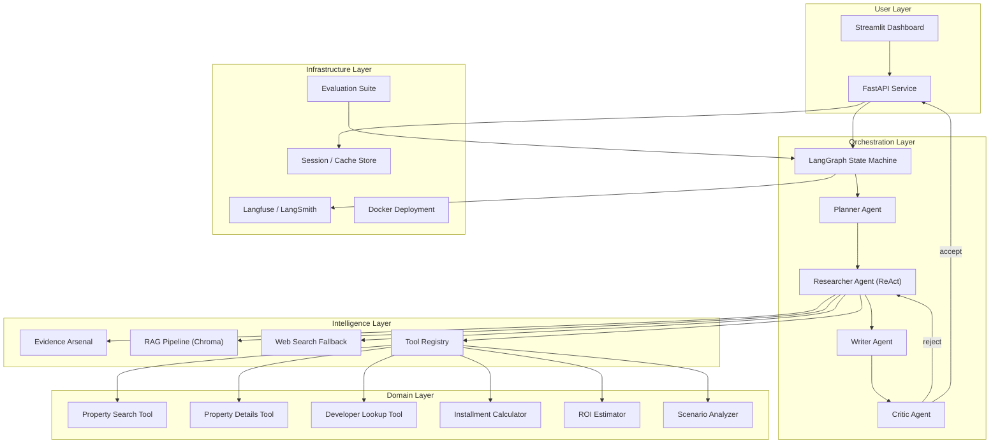
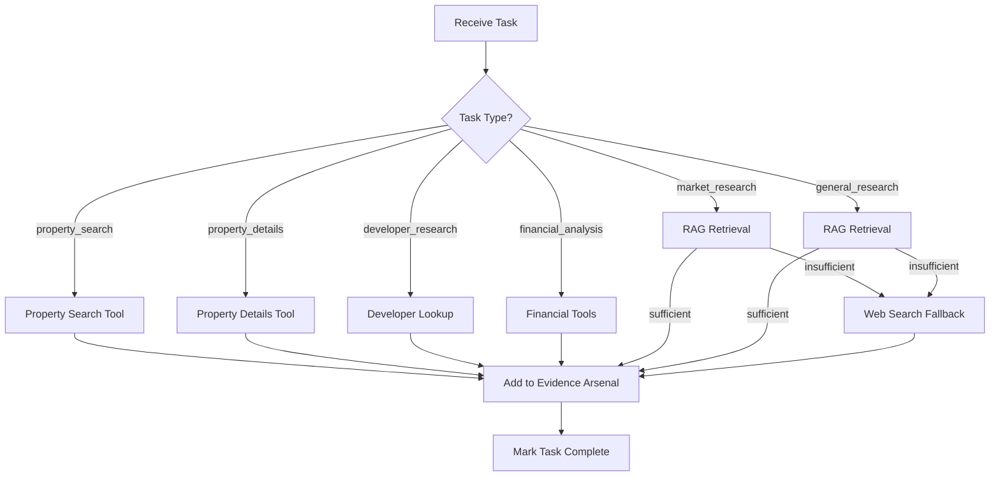
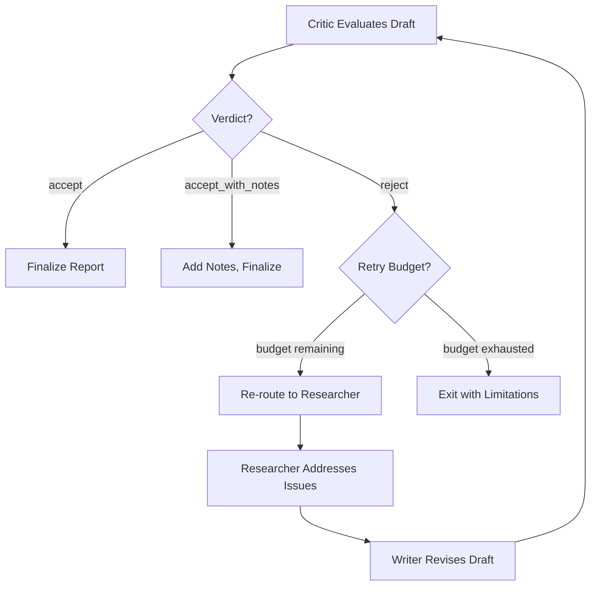
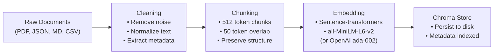
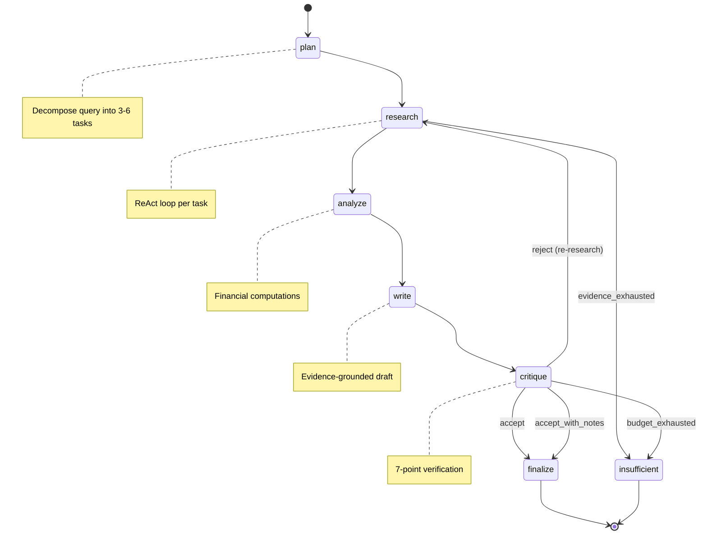
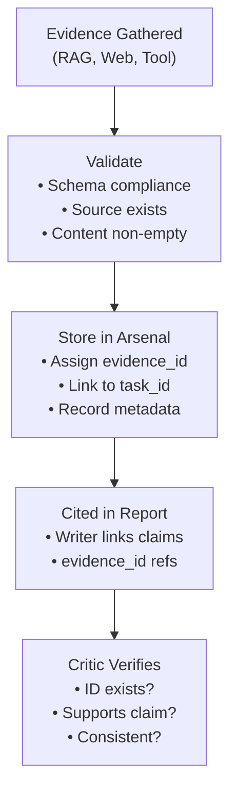
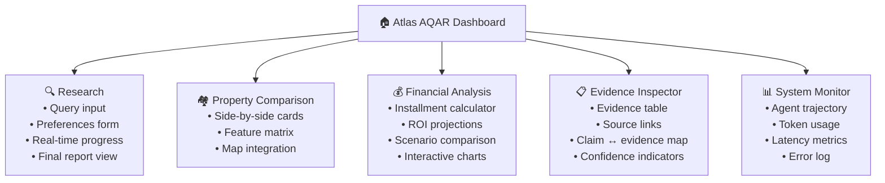
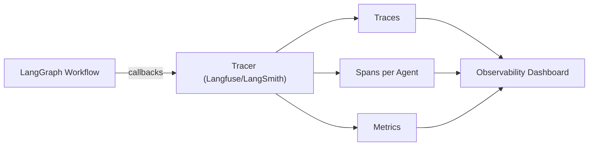

# Atlas AQAR — Technical Implementation Plan

> **Agentic AI–Driven Real-Estate Research and Investment Intelligence System**
> Four-Week Integrated Development Plan

---

## Table of Contents

1. [High-Level Architecture](#1-high-level-architecture)
2. [Repository Structure](#2-repository-structure)
3. [Typed State Contracts (Pydantic Models)](#3-typed-state-contracts)
4. [Agent Architecture Deep-Dive](#4-agent-architecture)
5. [Tool Registry & Real-Estate Tools](#5-tool-registry)
6. [RAG Pipeline Design](#6-rag-pipeline)
7. [LangGraph Workflow & Routing Logic](#7-langgraph-workflow)
8. [Evidence Management System](#8-evidence-management)
9. [Financial Engine](#9-financial-engine)
10. [Backend API (FastAPI)](#10-backend-api)
11. [Frontend Dashboard (Streamlit)](#11-frontend-dashboard)
12. [Observability & Tracing](#12-observability)
13. [Evaluation Framework](#13-evaluation-framework)
14. [Security & Bounded Autonomy](#14-security--bounded-autonomy)
15. [Deployment (Docker)](#15-deployment)
16. [Weekly Delivery Milestones (Detailed)](#16-weekly-milestones)
17. [Risk Register & Mitigations](#17-risk-register)

---

## 1. High-Level Architecture



### Core Architectural Principles

| Principle | Implementation |
|---|---|
| Evidence before assertion | Every material claim links to an `EvidenceRecord` with source metadata |
| Deterministic computation | All arithmetic handled by validated Python tools, never by LLM generation |
| Bounded autonomy | Retry caps (3), graph iterations (≤10), token budget, timeout per agent |
| Transparent uncertainty | Confidence levels + explicit "insufficient evidence" signaling |
| Untrusted-data isolation | Web content treated as data, never injected into system prompts |
| Separation of concerns | Agents reason _what_ to do; deterministic services _execute_ |
| Reproducibility | Seeded configs, fixed embeddings, deterministic tool outputs, cached runs |

---

## 2. Repository Structure

```
atlas_aqar/
├── pyproject.toml                    # Project metadata & dependencies (uv/pip)
├── .env.example                      # Environment variable template
├── docker-compose.yml                # Multi-service deployment
├── Dockerfile                        # Application container
├── Makefile                          # Common development commands
│
├── config/
│   ├── settings.py                   # Pydantic Settings (env-backed)
│   ├── prompts/                      # All agent prompt templates (YAML)
│   │   ├── planner.yaml
│   │   ├── researcher.yaml
│   │   ├── writer.yaml
│   │   └── critic.yaml
│   └── logging.yaml                  # Structured logging config
│
├── src/
│   ├── __init__.py
│   │
│   ├── models/                       # Pydantic data contracts
│   │   ├── __init__.py
│   │   ├── state.py                  # GraphState, AgentState
│   │   ├── evidence.py               # EvidenceRecord, EvidenceArsenal
│   │   ├── research.py               # ResearchPlan, ResearchTask
│   │   ├── property.py               # PropertyListing, Developer, PaymentPlan
│   │   ├── financial.py              # InstallmentSchedule, ROIResult, Scenario
│   │   ├── report.py                 # ReportSection, FinalReport
│   │   └── session.py                # UserSession, Preferences, CacheEntry
│   │
│   ├── agents/                       # Agent implementations
│   │   ├── __init__.py
│   │   ├── planner.py                # Planner agent
│   │   ├── researcher.py             # ReAct researcher agent
│   │   ├── writer.py                 # Evidence-grounded writer
│   │   ├── critic.py                 # Verification & critique agent
│   │   └── prompts.py                # Prompt loading utilities
│   │
│   ├── tools/                        # Tool implementations
│   │   ├── __init__.py
│   │   ├── registry.py               # Tool registry & dispatch
│   │   ├── property_search.py        # Property search & filter
│   │   ├── property_details.py       # Detailed property info
│   │   ├── developer_lookup.py       # Developer info & portfolio
│   │   ├── installment_calc.py       # Payment plan calculator
│   │   ├── roi_estimator.py          # ROI / yield estimation
│   │   ├── scenario_analyzer.py      # What-if scenario analysis
│   │   ├── rag_retriever.py          # RAG retrieval tool wrapper
│   │   └── web_search.py             # Controlled web search fallback
│   │
│   ├── rag/                          # RAG pipeline
│   │   ├── __init__.py
│   │   ├── ingestion.py              # Document loading, cleaning, chunking
│   │   ├── embeddings.py             # Embedding model management
│   │   ├── vectorstore.py            # Chroma collection management
│   │   ├── retriever.py              # Retrieval with metadata filtering
│   │   └── reranker.py               # Optional re-ranking step
│   │
│   ├── graph/                        # LangGraph orchestration
│   │   ├── __init__.py
│   │   ├── workflow.py               # Graph definition & compilation
│   │   ├── nodes.py                  # Node functions wrapping agents
│   │   ├── edges.py                  # Conditional edge functions
│   │   └── state.py                  # Shared graph state management
│   │
│   ├── engine/                       # Financial computation engine
│   │   ├── __init__.py
│   │   ├── installments.py           # Installment/payment-plan logic
│   │   ├── roi.py                    # ROI / yield / appreciation calc
│   │   ├── scenarios.py              # Multi-scenario comparison
│   │   └── validators.py             # Financial validation rules
│   │
│   ├── api/                          # FastAPI backend
│   │   ├── __init__.py
│   │   ├── main.py                   # App factory & middleware
│   │   ├── routes/
│   │   │   ├── research.py           # /research endpoints
│   │   │   ├── properties.py         # /properties endpoints
│   │   │   ├── financial.py          # /financial endpoints
│   │   │   └── health.py             # /health, /ready
│   │   ├── schemas.py                # API request/response schemas
│   │   ├── dependencies.py           # Dependency injection
│   │   └── middleware.py             # Error handling, logging
│   │
│   ├── dashboard/                    # Streamlit frontend
│   │   ├── app.py                    # Main Streamlit app
│   │   ├── pages/
│   │   │   ├── research.py           # Research query & results
│   │   │   ├── comparison.py         # Property comparison view
│   │   │   ├── financial.py          # Financial analysis view
│   │   │   ├── evidence.py           # Evidence inspector
│   │   │   └── monitoring.py         # System monitoring view
│   │   ├── components/               # Reusable UI components
│   │   │   ├── property_card.py
│   │   │   ├── evidence_table.py
│   │   │   ├── financial_chart.py
│   │   │   └── progress_tracker.py
│   │   └── styles/
│   │       └── custom.css
│   │
│   └── observability/                # Tracing & monitoring
│       ├── __init__.py
│       ├── tracer.py                 # Langfuse/LangSmith integration
│       ├── metrics.py                # Custom metrics collection
│       └── callbacks.py             # LangChain callback handlers
│
├── data/
│   ├── raw/                          # Raw property data & documents
│   ├── processed/                    # Cleaned & chunked documents
│   ├── chroma_db/                    # Persisted Chroma vector store
│   └── benchmarks/                   # Evaluation benchmark datasets
│       ├── benchmark_questions.json
│       └── reference_answers.json
│
├── tests/
│   ├── conftest.py                   # Shared fixtures
│   ├── unit/
│   │   ├── test_models.py
│   │   ├── test_tools.py
│   │   ├── test_financial_engine.py
│   │   ├── test_rag_pipeline.py
│   │   └── test_evidence.py
│   ├── integration/
│   │   ├── test_graph_workflow.py
│   │   ├── test_agent_pipeline.py
│   │   └── test_api_endpoints.py
│   ├── evaluation/
│   │   ├── test_benchmark.py
│   │   ├── test_retrieval_quality.py
│   │   ├── test_groundedness.py
│   │   └── test_adversarial.py
│   └── e2e/
│       └── test_full_workflow.py
│
├── scripts/
│   ├── ingest_data.py                # Data ingestion runner
│   ├── run_evaluation.py             # Evaluation suite runner
│   ├── run_ablation.py               # Ablation study runner
│   └── generate_report.py            # Report generation script
│
├── docs/
│   ├── architecture.md               # Architecture documentation
│   ├── api_reference.md              # API documentation
│   ├── evaluation_report.md          # Evaluation results
│   ├── ablation_study.md             # Ablation analysis
│   └── limitations.md                # Known limitations
│
└── notebooks/
    ├── 01_data_exploration.ipynb
    ├── 02_rag_experiments.ipynb
    └── 03_evaluation_analysis.ipynb
```

---

## 3. Typed State Contracts

All data flowing through the system uses Pydantic models for validation, serialization, and documentation.

### 3.1 Core Graph State

```python
# src/models/state.py

from pydantic import BaseModel, Field
from typing import Optional
from enum import Enum

class WorkflowPhase(str, Enum):
    PLANNING = "planning"
    RESEARCHING = "researching"
    WRITING = "writing"
    CRITIQUING = "critiquing"
    COMPLETE = "complete"
    FAILED = "failed"
    INSUFFICIENT_EVIDENCE = "insufficient_evidence"

class GraphState(BaseModel):
    """Central typed state shared across all agents in the LangGraph workflow."""

    # --- User Input ---
    user_query: str
    session_id: str
    user_preferences: Optional["UserPreferences"] = None

    # --- Workflow Control ---
    phase: WorkflowPhase = WorkflowPhase.PLANNING
    iteration_count: int = 0
    max_iterations: int = Field(default=10)
    retry_count: int = 0
    max_retries: int = Field(default=3)
    total_tokens_used: int = 0
    token_budget: int = Field(default=100_000)
    error_log: list[str] = Field(default_factory=list)

    # --- Planner Output ---
    research_plan: Optional["ResearchPlan"] = None

    # --- Researcher Output ---
    evidence_arsenal: "EvidenceArsenal" = Field(default_factory=EvidenceArsenal)
    completed_tasks: list[str] = Field(default_factory=list)
    pending_tasks: list[str] = Field(default_factory=list)

    # --- Property & Financial Results ---
    property_results: list["PropertyListing"] = Field(default_factory=list)
    financial_results: list["FinancialAnalysis"] = Field(default_factory=list)
    comparison_matrix: Optional["ComparisonMatrix"] = None

    # --- Writer Output ---
    draft_report: Optional["DraftReport"] = None

    # --- Critic Output ---
    critique: Optional["CritiqueResult"] = None
    critique_history: list["CritiqueResult"] = Field(default_factory=list)

    # --- Final Output ---
    final_report: Optional["FinalReport"] = None
```

### 3.2 Research Models

```python
# src/models/research.py

class ResearchTask(BaseModel):
    """A single decomposed research task."""
    task_id: str
    description: str
    priority: int = Field(ge=1, le=6)
    task_type: Literal[
        "property_search", "property_details", "developer_research",
        "financial_analysis", "market_research", "comparison",
        "scenario_analysis", "general_research"
    ]
    dependencies: list[str] = Field(default_factory=list)
    required_tools: list[str] = Field(default_factory=list)
    completion_criteria: str
    status: Literal["pending", "in_progress", "completed", "failed", "skipped"] = "pending"

class ResearchPlan(BaseModel):
    """Structured plan produced by the Planner agent."""
    plan_id: str
    original_query: str
    interpreted_intent: str
    constraints_extracted: dict[str, Any]
    tasks: list[ResearchTask] = Field(min_length=1, max_length=8)
    execution_order: list[str]  # task_ids in dependency-resolved order
    estimated_complexity: Literal["simple", "moderate", "complex"]
```

### 3.3 Evidence Models

```python
# src/models/evidence.py

class EvidenceRecord(BaseModel):
    """A single piece of retrieved or computed evidence."""
    evidence_id: str                              # e.g., "E001"
    task_id: str                                  # which research task produced this
    source_type: Literal[
        "rag_retrieval", "web_search", "property_tool",
        "developer_tool", "financial_calculation",
        "user_provided", "derived"
    ]
    source_reference: str                         # URL, document name, tool name
    retrieval_method: str                         # e.g., "semantic_search", "metadata_filter"
    content: str                                  # the actual evidence text
    metadata: dict[str, Any] = Field(default_factory=dict)
    confidence: float = Field(ge=0.0, le=1.0)
    timestamp: datetime
    date_of_source: Optional[str] = None          # when the source data was published/updated

class EvidenceArsenal(BaseModel):
    """Collection of all evidence gathered during research."""
    records: list[EvidenceRecord] = Field(default_factory=list)
    
    def get_by_task(self, task_id: str) -> list[EvidenceRecord]: ...
    def get_by_id(self, evidence_id: str) -> Optional[EvidenceRecord]: ...
    def get_by_type(self, source_type: str) -> list[EvidenceRecord]: ...
    def add(self, record: EvidenceRecord) -> None: ...
    def summary(self) -> dict[str, int]: ...
```

### 3.4 Property & Financial Models

```python
# src/models/property.py

class PaymentPlan(BaseModel):
    """Structured installment/payment plan for a property."""
    plan_name: str
    total_price: float
    currency: str = "EGP"
    down_payment_percentage: float
    down_payment_amount: float
    number_of_installments: int
    installment_amount: float
    installment_frequency: Literal["monthly", "quarterly", "semi_annual", "annual"]
    duration_years: float
    interest_rate: Optional[float] = None         # 0.0 if interest-free
    maintenance_deposit: Optional[float] = None
    club_membership: Optional[float] = None
    notes: Optional[str] = None

class PropertyListing(BaseModel):
    """A real-estate property listing."""
    property_id: str
    project_name: str
    developer_name: str
    property_type: Literal[
        "apartment", "villa", "townhouse", "duplex",
        "penthouse", "studio", "chalet", "office",
        "retail", "land"
    ]
    location: str
    sub_location: Optional[str] = None
    area_sqm: float
    bedrooms: Optional[int] = None
    bathrooms: Optional[int] = None
    floor: Optional[int] = None
    finishing: Optional[Literal["finished", "semi_finished", "core_and_shell"]] = None
    delivery_date: Optional[str] = None
    price: float
    price_per_sqm: float
    payment_plans: list[PaymentPlan] = Field(default_factory=list)
    amenities: list[str] = Field(default_factory=list)
    evidence_ids: list[str] = Field(default_factory=list)

class Developer(BaseModel):
    """Real-estate developer information."""
    developer_id: str
    name: str
    established_year: Optional[int] = None
    headquarters: Optional[str] = None
    notable_projects: list[str] = Field(default_factory=list)
    total_delivered_units: Optional[int] = None
    reputation_notes: Optional[str] = None
    evidence_ids: list[str] = Field(default_factory=list)
```

```python
# src/models/financial.py

class InstallmentSchedule(BaseModel):
    """Detailed installment breakdown."""
    property_id: str
    plan_name: str
    total_price: float
    down_payment: float
    installments: list[dict]   # [{period, date, amount, balance_after}]
    total_paid: float
    effective_annual_rate: Optional[float] = None

class ROIResult(BaseModel):
    """Return on Investment estimation result."""
    property_id: str
    purchase_price: float
    estimated_current_value: Optional[float] = None
    annual_appreciation_rate: float               # assumption
    projected_value_years: dict[int, float]       # {1: X, 3: Y, 5: Z}
    estimated_rental_yield: Optional[float] = None
    total_roi_percentage: Optional[float] = None
    assumptions: list[str]                        # explicit list of assumptions made
    confidence_level: Literal["low", "medium", "high"]
    evidence_ids: list[str] = Field(default_factory=list)

class ScenarioResult(BaseModel):
    """A single what-if scenario analysis."""
    scenario_name: str
    description: str
    parameters_changed: dict[str, Any]
    financial_outcome: ROIResult
    comparison_to_base: dict[str, float]          # delta vs. baseline
```

### 3.5 Report Models

```python
# src/models/report.py

class CitedClaim(BaseModel):
    """A claim in the report with evidence linkage."""
    claim_text: str
    evidence_ids: list[str]
    claim_type: Literal["factual", "calculated", "assumption", "opinion"]

class ReportSection(BaseModel):
    """A section of the final report."""
    section_type: Literal[
        "executive_summary", "research_scope", "property_findings",
        "comparative_analysis", "financial_analysis",
        "market_context", "evidence_citations",
        "uncertainty_limitations", "final_synthesis"
    ]
    title: str
    content: str
    cited_claims: list[CitedClaim] = Field(default_factory=list)

class DraftReport(BaseModel):
    """Intermediate draft produced by the Writer."""
    draft_number: int
    sections: list[ReportSection]
    total_claims: int
    cited_claims: int
    uncited_claims: int

class FinalReport(BaseModel):
    """The final, critique-approved report."""
    report_id: str
    query: str
    sections: list[ReportSection]
    evidence_arsenal: EvidenceArsenal
    metadata: dict[str, Any]                      # tokens, latency, iterations
    generated_at: datetime
```

### 3.6 Critique Models

```python
# src/models/critique.py

class CritiqueIssue(BaseModel):
    """A single issue identified by the Critic."""
    issue_id: str
    category: Literal[
        "missing_evidence", "invalid_citation", "numerical_error",
        "constraint_violation", "unsupported_claim",
        "conflicting_sources", "incomplete_coverage",
        "formatting", "other"
    ]
    severity: Literal["critical", "major", "minor"]
    description: str
    affected_section: Optional[str] = None
    suggested_action: str

class CritiqueResult(BaseModel):
    """Full critique output."""
    critique_id: str
    draft_number: int
    verdict: Literal["accept", "reject", "accept_with_notes"]
    issues: list[CritiqueIssue] = Field(default_factory=list)
    re_research_tasks: list[str] = Field(default_factory=list)  # task_ids to redo
    overall_score: float = Field(ge=0.0, le=1.0)
    summary: str
```

---

## 4. Agent Architecture

### 4.1 Planner Agent

| Aspect | Detail |
|---|---|
| **Role** | Decompose the user's compound query into 3–6 prioritized, dependency-mapped research tasks |
| **Input** | `user_query`, `user_preferences` |
| **Output** | `ResearchPlan` with ordered `ResearchTask` list |
| **LLM Usage** | Single structured-output call with `ResearchPlan` as the response schema |
| **Key Logic** | Dependency resolution (topological sort), task-type assignment, tool pre-selection |
| **Constraints** | Max 8 tasks; each task must have completion criteria; no circular dependencies |

**Prompt Strategy:**
- System prompt defines the real-estate research domain, available tools, and output schema
- Few-shot examples of query → plan decomposition
- Constraint extraction from natural language (budget, location, bedrooms, etc.)

### 4.2 Researcher Agent (ReAct)

| Aspect | Detail |
|---|---|
| **Role** | Execute research tasks by dynamically selecting and invoking tools, gathering evidence |
| **Pattern** | ReAct (Reasoning + Acting) loop with Thought → Action → Observation cycles |
| **Input** | Current `ResearchTask`, `EvidenceArsenal`, available tools |
| **Output** | Updated `EvidenceArsenal`, task status, property/financial results |
| **Tool Selection** | Dynamic based on task type — RAG first, web fallback, domain tools as needed |
| **Max Steps** | 8 ReAct steps per task; 3 retries on tool failure |

**Tool Selection Strategy:**



### 4.3 Writer Agent

| Aspect | Detail |
|---|---|
| **Role** | Synthesize evidence into a structured, citation-grounded report |
| **Input** | `EvidenceArsenal`, `property_results`, `financial_results`, `comparison_matrix` |
| **Output** | `DraftReport` with `CitedClaim` objects linking text to `evidence_id`s |
| **Key Rule** | Every material factual or financial claim MUST reference ≥1 `evidence_id` |
| **Sections** | Follows the 9-section output structure from the proposal |
| **Anti-hallucination** | Prompt instructs: "If evidence is unavailable, state 'insufficient data' rather than generating content" |

### 4.4 Critic Agent

| Aspect | Detail |
|---|---|
| **Role** | Verify the draft report for evidence coverage, citation validity, numerical accuracy, constraint satisfaction |
| **Input** | `DraftReport`, `EvidenceArsenal`, `ResearchPlan`, `user_preferences` |
| **Output** | `CritiqueResult` with verdict, issues, and optional re-research tasks |
| **Checks** | 7 programmatic checks + LLM-based qualitative review |

**Critic Verification Checklist:**

| # | Check | Method |
|---|---|---|
| 1 | **Evidence existence** | Verify every cited `evidence_id` exists in the arsenal |
| 2 | **Citation support** | LLM check: does cited evidence actually support the claim? |
| 3 | **Numerical consistency** | Re-run financial calculations and compare to report values |
| 4 | **Constraint satisfaction** | Verify results match user's budget, location, bedrooms, etc. |
| 5 | **Unsupported claims** | Flag material claims without any `evidence_id` |
| 6 | **Conflicting sources** | Detect contradictions between evidence records |
| 7 | **Coverage completeness** | Check that all research tasks have evidence representation |

**Routing Decision:**



---

## 5. Tool Registry

### 5.1 Tool Interface

Every tool follows a uniform interface:

```python
from abc import ABC, abstractmethod

class BaseTool(ABC):
    name: str
    description: str
    parameters_schema: type[BaseModel]  # Pydantic model for tool input
    
    @abstractmethod
    def execute(self, params: BaseModel) -> ToolResult: ...

class ToolResult(BaseModel):
    success: bool
    data: Any
    evidence_records: list[EvidenceRecord] = []
    error_message: Optional[str] = None
    execution_time_ms: float
```

### 5.2 Real-Estate Tools

| Tool | Input | Output | Data Source |
|---|---|---|---|
| `PropertySearchTool` | Filters (location, type, budget, beds, area) | List of `PropertyListing` | Local dataset / RAG |
| `PropertyDetailsTool` | `property_id` | Full `PropertyListing` with all plans | Local dataset |
| `DeveloperLookupTool` | Developer name or ID | `Developer` info | Local dataset / RAG |
| `InstallmentCalcTool` | Price, down %, installments, rate | `InstallmentSchedule` | Deterministic calculation |
| `ROIEstimatorTool` | Purchase price, appreciation %, rental yield, horizon | `ROIResult` | Deterministic calculation |
| `ScenarioAnalyzerTool` | Base params + list of modified scenarios | List of `ScenarioResult` | Deterministic calculation |
| `RAGRetrieverTool` | Query + optional metadata filters | Retrieved document chunks | Chroma vector store |
| `WebSearchTool` | Search query + max results | Search result summaries | Web search API (SerpAPI / Tavily) |

### 5.3 Tool Registration

```python
# src/tools/registry.py

class ToolRegistry:
    """Central registry for all available tools."""
    
    def __init__(self):
        self._tools: dict[str, BaseTool] = {}
    
    def register(self, tool: BaseTool) -> None: ...
    def get(self, name: str) -> BaseTool: ...
    def list_tools(self) -> list[dict]: ...           # for agent tool descriptions
    def get_for_task_type(self, task_type: str) -> list[BaseTool]: ...
```

---

## 6. RAG Pipeline

### 6.1 Ingestion Pipeline



### 6.2 Document Types & Metadata Schema

| Document Type | Metadata Fields |
|---|---|
| Property Listing | `property_id`, `project_name`, `developer`, `location`, `property_type`, `price_range`, `bedrooms` |
| Developer Profile | `developer_id`, `developer_name`, `doc_type=developer` |
| Payment Plan | `property_id`, `plan_name`, `doc_type=payment_plan` |
| Market Report | `region`, `date`, `doc_type=market_report` |
| Location Guide | `location`, `doc_type=location_guide` |

### 6.3 Retrieval Strategy

```python
# Retrieval with metadata filtering + similarity search

class RAGRetriever:
    def retrieve(
        self,
        query: str,
        top_k: int = 5,
        metadata_filters: Optional[dict] = None,
        min_relevance_score: float = 0.7,
    ) -> list[RetrievedChunk]:
        """
        1. Apply metadata filters (pre-filter)
        2. Semantic similarity search
        3. Score threshold filtering
        4. (Optional) Cross-encoder reranking
        5. Return ranked chunks with metadata
        """
```

### 6.4 RAG Quality Controls

| Control | Implementation |
|---|---|
| Chunk overlap | 50-token overlap to preserve context across boundaries |
| Metadata filtering | Pre-filter by `property_type`, `location`, `developer`, `price_range` before similarity search |
| Minimum score | Discard chunks below 0.7 cosine similarity |
| Source deduplication | Deduplicate chunks from same source document |
| Freshness | Prefer more recent documents when dates are available |
| Fallback | If < 2 relevant chunks returned, trigger web search fallback |

---

## 7. LangGraph Workflow

### 7.1 Graph Definition



### 7.2 Node Definitions

```python
# src/graph/nodes.py

def plan_node(state: GraphState) -> GraphState:
    """Planner: decompose query → ResearchPlan."""
    
def research_node(state: GraphState) -> GraphState:
    """Researcher: execute pending tasks via ReAct loop."""
    
def analyze_node(state: GraphState) -> GraphState:
    """Run deterministic financial calculations on gathered data."""

def write_node(state: GraphState) -> GraphState:
    """Writer: synthesize evidence → DraftReport."""
    
def critique_node(state: GraphState) -> GraphState:
    """Critic: verify draft → CritiqueResult with verdict."""

def finalize_node(state: GraphState) -> GraphState:
    """Package final report and metadata."""

def insufficient_evidence_node(state: GraphState) -> GraphState:
    """Graceful exit with documented limitations."""
```

### 7.3 Conditional Edges

```python
# src/graph/edges.py

def route_after_critique(state: GraphState) -> str:
    """Determine next node after critique."""
    if state.critique.verdict == "accept":
        return "finalize"
    if state.critique.verdict == "accept_with_notes":
        return "finalize"
    if state.retry_count >= state.max_retries:
        return "insufficient_evidence"
    if state.iteration_count >= state.max_iterations:
        return "insufficient_evidence"
    if state.total_tokens_used >= state.token_budget:
        return "insufficient_evidence"
    return "research"  # re-route for targeted re-research

def route_after_research(state: GraphState) -> str:
    """Check if research is sufficient or needs more."""
    if not state.evidence_arsenal.records:
        return "insufficient_evidence"
    return "analyze"
```

### 7.4 Graph Compilation

```python
# src/graph/workflow.py

from langgraph.graph import StateGraph, END

def build_workflow() -> StateGraph:
    workflow = StateGraph(GraphState)
    
    # Add nodes
    workflow.add_node("plan", plan_node)
    workflow.add_node("research", research_node)
    workflow.add_node("analyze", analyze_node)
    workflow.add_node("write", write_node)
    workflow.add_node("critique", critique_node)
    workflow.add_node("finalize", finalize_node)
    workflow.add_node("insufficient_evidence", insufficient_evidence_node)
    
    # Add edges
    workflow.set_entry_point("plan")
    workflow.add_edge("plan", "research")
    workflow.add_conditional_edges("research", route_after_research)
    workflow.add_edge("analyze", "write")
    workflow.add_edge("write", "critique")
    workflow.add_conditional_edges("critique", route_after_critique)
    workflow.add_edge("finalize", END)
    workflow.add_edge("insufficient_evidence", END)
    
    return workflow.compile()
```

---

## 8. Evidence Management System

### 8.1 Evidence Lifecycle



### 8.2 Evidence ID Convention

Format: `E{NNN}` (e.g., `E001`, `E002`, ...)

Automatically assigned by `EvidenceArsenal.add()` based on insertion order, ensuring unique, traceable references throughout the pipeline.

---

## 9. Financial Engine

### 9.1 Installment Calculator

```python
# src/engine/installments.py

def calculate_installment_schedule(
    total_price: float,
    down_payment_pct: float,
    num_installments: int,
    frequency: str,           # "monthly", "quarterly", etc.
    interest_rate: float = 0.0,
    extras: dict = None,      # maintenance, club, etc.
) -> InstallmentSchedule:
    """
    Deterministic installment calculation.
    - Handles interest-free and interest-bearing plans
    - Generates full amortization schedule
    - Validates: total_paid ≈ total_price (within rounding)
    - All arithmetic is exact (Decimal), never LLM-generated
    """
```

### 9.2 ROI Estimator

```python
# src/engine/roi.py

def estimate_roi(
    purchase_price: float,
    appreciation_rates: list[float],  # e.g., [0.08, 0.10, 0.12] per year
    rental_yield_pct: Optional[float],
    holding_period_years: int,
    expenses_pct: float = 0.02,       # maintenance, taxes
) -> ROIResult:
    """
    Deterministic ROI projection.
    - Uses compound appreciation formula
    - Calculates net rental yield after expenses
    - Explicitly lists all assumptions
    - Confidence level based on data quality
    """
```

### 9.3 Scenario Analyzer

```python
# src/engine/scenarios.py

def analyze_scenarios(
    base_params: dict,
    scenarios: list[dict],     # each modifies 1+ params
) -> list[ScenarioResult]:
    """
    Compare financial outcomes across parameter variations.
    E.g., "What if appreciation is 5% vs 10% vs 15%?"
         "What if I choose Plan A vs Plan B?"
    """
```

### 9.4 Validation Rules

| Rule | Check |
|---|---|
| Price sanity | `price > 0`, `price_per_sqm > 0` |
| Installment balance | `down_payment + sum(installments) ≈ total_price` (±0.01) |
| Rate bounds | `0 ≤ interest_rate ≤ 0.5`, `0 ≤ appreciation_rate ≤ 0.5` |
| Division by zero | All divisors checked before computation |
| Currency consistency | All values in same currency within a calculation |

---

## 10. Backend API (FastAPI)

### 10.1 Endpoint Design

```
POST /api/v1/research
     Body: { query: str, preferences?: UserPreferences }
     Response: { research_id: str, status: str }
     → Triggers async LangGraph workflow

GET  /api/v1/research/{research_id}
     Response: { status, progress, partial_results?, final_report? }

GET  /api/v1/research/{research_id}/evidence
     Response: { evidence_arsenal: EvidenceArsenal }

GET  /api/v1/research/{research_id}/trajectory
     Response: { phases, agent_actions, tool_calls, timings }

POST /api/v1/properties/search
     Body: { filters: PropertyFilters }
     Response: { properties: list[PropertyListing] }

GET  /api/v1/properties/{property_id}
     Response: { property: PropertyListing }

POST /api/v1/financial/installments
     Body: { InstallmentCalcInput }
     Response: { schedule: InstallmentSchedule }

POST /api/v1/financial/roi
     Body: { ROIInput }
     Response: { result: ROIResult }

POST /api/v1/financial/scenarios
     Body: { ScenarioInput }
     Response: { results: list[ScenarioResult] }

GET  /api/v1/health
     Response: { status: "healthy", version, uptime }
```

### 10.2 Middleware Stack

| Middleware | Purpose |
|---|---|
| `CORSMiddleware` | Enable Streamlit → API communication |
| `RequestLoggingMiddleware` | Log all requests with timing |
| `ErrorHandlingMiddleware` | Structured error responses |
| `RateLimitMiddleware` | Basic rate limiting per session |
| `TracingMiddleware` | Inject trace IDs for observability |

### 10.3 Caching Strategy

| Cache Layer | Technology | TTL | Use Case |
|---|---|---|---|
| Property data | In-memory (dict) | Session lifetime | Avoid re-querying static listings |
| RAG results | LRU cache | 30 min | Repeated similar queries |
| Financial calcs | Request-level | Per request | Avoid redundant recalculation |
| Web search | Disk cache | 24 hours | Rate limit protection |

---

## 11. Frontend Dashboard (Streamlit)

### 11.1 Page Architecture



### 11.2 Key UI Components

| Component | Description |
|---|---|
| `PropertyCard` | Rich card with image placeholder, key stats, price, location badge |
| `EvidenceTable` | Sortable table of evidence records with source, type, confidence |
| `FinancialChart` | Plotly charts for installment schedules, ROI projections, scenarios |
| `ProgressTracker` | Real-time agent phase indicator with task completion status |
| `ReportViewer` | Formatted report with inline citation highlighting and evidence links |
| `ComparisonMatrix` | Side-by-side property attribute comparison grid |

### 11.3 Session State Management

```python
# Streamlit session state keys
st.session_state.research_id        # Current research ID
st.session_state.user_preferences   # Saved user preferences
st.session_state.research_history   # Past research sessions
st.session_state.selected_properties # Properties for comparison
```

---

## 12. Observability

### 12.1 Tracing Architecture



### 12.2 Metrics Collected

| Category | Metrics |
|---|---|
| **Latency** | Total workflow time, per-agent time, per-tool time |
| **Tokens** | Input tokens, output tokens, total tokens, per-agent breakdown |
| **Cost** | Estimated cost per request (based on model pricing) |
| **Quality** | Evidence count, citation rate, critic pass/fail rate |
| **Reliability** | Error rate, retry count, timeout count, fallback triggers |
| **Cache** | Cache hit rate, cache miss rate |

### 12.3 Trajectory Logging

Every agent step is logged as a structured event:

```python
{
    "trace_id": "...",
    "span_id": "...",
    "agent": "researcher",
    "step_type": "thought|action|observation",
    "tool_called": "PropertySearchTool",
    "input": {...},
    "output": {...},
    "tokens_used": 450,
    "duration_ms": 1200,
    "timestamp": "..."
}
```

---

## 13. Evaluation Framework

### 13.1 Benchmark Dataset Structure

```json
{
    "benchmark_id": "BM001",
    "category": "normal|complex|unanswerable|contradictory|adversarial|financial",
    "query": "Find me a 2-bedroom apartment in New Cairo under 3M EGP with a 10-year payment plan",
    "expected_behavior": {
        "should_find_properties": true,
        "expected_property_count_range": [1, 5],
        "required_sections": ["property_findings", "financial_analysis"],
        "financial_checks": {
            "installment_calculation": true,
            "roi_estimation": true
        },
        "should_acknowledge_limitations": false
    },
    "reference_answer_key_points": [
        "Properties in New Cairo",
        "Under 3M EGP",
        "2 bedrooms",
        "Payment plan ≥ 10 years"
    ]
}
```

### 13.2 Evaluation Metrics

| Metric | Tool/Method | Target |
|---|---|---|
| **Task Completion** | Automated benchmark runner | ≥ 80% |
| **Citation Precision** | Programmatic: `valid_citations / total_citations` | > 90% |
| **Groundedness** | RAGAS faithfulness metric + manual review | High (improved over baseline) |
| **Financial Accuracy** | Unit tests vs. reference calculations | 100% |
| **Evidence Coverage** | `supported_claims / total_material_claims` | High |
| **Critic Efficacy** | Compare Draft 1 vs. Final (corrections made) | Measurable improvement |
| **Unsupported Claim Rate** | Automated + human audit | Near-zero |
| **Latency** | Trace p50, p95, p99 | Measured, bounded |
| **Cost** | Token-based cost estimation | Measured, bounded |
| **Robustness** | Adversarial test pass rate | No unhandled failures |

### 13.3 Ablation Study Design

| Configuration | Components Active |
|---|---|
| **Base LLM** | LLM only, no tools, no RAG |
| **LLM + RAG** | LLM + Chroma retrieval |
| **LLM + RAG + Tools** | LLM + Chroma + property/financial tools |
| **Full Atlas AQAR** | Complete multi-agent system with critique loop |

Measured across: Task Completion, Groundedness, Citation Precision, Financial Accuracy, Latency.

### 13.4 Adversarial Test Cases

| Test | Input | Expected Behavior |
|---|---|---|
| Prompt injection in content | Property listing with "ignore previous instructions" | System treats as data, not instructions |
| Missing data | Query for location with no listings | Graceful "insufficient data" response |
| Conflicting sources | Two sources with different prices | Acknowledge conflict, present both |
| Impossible constraints | "Villa under 100K EGP in New Cairo" | Explain no matches; suggest relaxed criteria |
| Malformed input | Empty query, special characters | Validation error with helpful message |
| Excessive loops | Query that could trigger infinite research | Respects iteration limit, exits gracefully |
| Calculation edge cases | Zero down payment, 100% interest | Valid calculation or appropriate error |

---

## 14. Security & Bounded Autonomy

### 14.1 Autonomy Bounds

| Bound | Default | Purpose |
|---|---|---|
| Max graph iterations | 10 | Prevent infinite loops |
| Max retries (critique) | 3 | Bound critique-research cycles |
| Max ReAct steps per task | 8 | Bound researcher tool calls |
| Token budget | 100,000 | Cost control |
| Request timeout | 300s | Prevent hung requests |
| Web search rate limit | 10/min | API protection |

### 14.2 Security Controls

| Control | Implementation |
|---|---|
| Input validation | Pydantic models with constrained fields |
| Untrusted data isolation | Web content never injected into system prompts; treated as `observation` data only |
| Prompt injection defense | Retrieved content wrapped in data delimiters; system prompts clearly separated |
| API authentication | API key-based auth for FastAPI endpoints |
| Error information | No stack traces in API responses; structured error objects only |
| Dependency pinning | Lock file for all Python dependencies |

---

## 15. Deployment

### 15.1 Docker Architecture

```yaml
# docker-compose.yml
services:
  api:
    build: .
    ports: ["8000:8000"]
    env_file: .env
    volumes:
      - ./data:/app/data
    depends_on:
      - chroma

  dashboard:
    build:
      context: .
      dockerfile: Dockerfile.streamlit
    ports: ["8501:8501"]
    env_file: .env
    depends_on:
      - api

  chroma:
    image: chromadb/chroma:latest
    ports: ["8200:8000"]
    volumes:
      - chroma_data:/chroma/chroma

volumes:
  chroma_data:
```

### 15.2 Environment Configuration

```bash
# .env.example
LLM_API_KEY=                      # OpenAI / Anthropic / other
LLM_MODEL=gpt-4o                  # or gpt-4o-mini for cost reduction
EMBEDDING_MODEL=all-MiniLM-L6-v2  # or text-embedding-3-small
WEB_SEARCH_API_KEY=               # Tavily or SerpAPI
CHROMA_HOST=chroma
CHROMA_PORT=8000
LANGFUSE_PUBLIC_KEY=              # optional
LANGFUSE_SECRET_KEY=              # optional
LOG_LEVEL=INFO
MAX_ITERATIONS=10
TOKEN_BUDGET=100000
```

---

## 16. Weekly Milestones (Detailed)

### Week 1: Foundation, Data & Single-Agent Core

| Day | Tasks | Deliverables |
|---|---|---|
| **D1-D2** | • Freeze architecture & typed contracts<br/>• Set up repository, pyproject.toml, CI<br/>• Implement all Pydantic models<br/>• Set up config management & logging | Repository skeleton, all data models, config system |
| **D3** | • Prepare 30-50 property dataset (JSON/MD)<br/>• Create developer profiles, payment plans, market docs<br/>• Assign metadata to all documents | Validated real-estate dataset |
| **D4** | • Implement RAG ingestion pipeline<br/>• Clean, chunk, embed, index into Chroma<br/>• Implement metadata-filtered retrieval<br/>• Write initial retrieval tests | Working RAG pipeline |
| **D5** | • Implement all 6 real-estate tools with schemas<br/>• Implement tool registry<br/>• Write unit tests for every tool | Validated tool suite |
| **D6** | • Build standalone Researcher ReAct loop<br/>• Connect to RAG + tools + web fallback<br/>• Run representative queries | Standalone Researcher |
| **D7** | • Initial Streamlit prototype<br/>• API skeleton (FastAPI)<br/>• Docker foundation<br/>• **Gate 1 review** | Prototypes, Gate 1 passed |

> [!IMPORTANT]
> **Gate 1 Criteria**: Researcher answers 5+ representative questions with explicit source references and reproducible tool traces.

### Week 2: Multi-Agent Orchestration

| Day | Tasks | Deliverables |
|---|---|---|
| **D8-D9** | • Implement LangGraph state schema<br/>• Build graph workflow with all nodes<br/>• Implement conditional edges<br/>• Implement Planner agent | Working graph + Planner |
| **D10** | • Extend Researcher for multi-task execution<br/>• Implement Evidence Arsenal management<br/>• Add domain-aware tool selection | Domain-aware Researcher |
| **D11** | • Implement Writer with citation grounding<br/>• Implement 9-section report structure<br/>• Enforce evidence_id linking | Citation-grounded Writer |
| **D12** | • Implement Critic with 7-point checklist<br/>• Implement conditional re-routing<br/>• Add retry caps & failure handling | Critic + re-routing |
| **D13** | • End-to-end integration testing<br/>• Token/cost budget enforcement<br/>• Untrusted data isolation | E2E tests passing |
| **D14** | • Financial analysis workflow integration<br/>• **Gate 2 review** | Full cycle working, Gate 2 passed |

> [!IMPORTANT]
> **Gate 2 Criteria**: Full Planner→Researcher→Analyze→Writer→Critic cycle completes majority of benchmark questions. Critique-triggered re-research demonstrably improves output.

### Week 3: Evaluation, Observability & Hardening

| Day | Tasks | Deliverables |
|---|---|---|
| **D15-D16** | • Integrate Langfuse/LangSmith tracing<br/>• Build evaluation benchmark (25-50 cases)<br/>• Implement automated evaluation runner | Tracing + benchmark suite |
| **D17** | • Run full evaluation suite<br/>• Measure all 10 performance metrics<br/>• Document initial results | Performance matrix v1 |
| **D18** | • Conduct 4-configuration ablation study<br/>• Generate comparative charts | Ablation study results |
| **D19** | • Adversarial testing (7+ test types)<br/>• Robustness hardening<br/>• Edge case fixes | Adversarial test report |
| **D20** | • Refine dashboard, API, caching<br/>• System documentation updates<br/>• **Gate 3 review** | Feature freeze, Gate 3 passed |

> [!IMPORTANT]
> **Gate 3 Criteria**: Feature freeze. All metrics measured. Known limitations documented. No unhandled failures in adversarial suite.

### Week 4: Integration, Deployment & Demo

| Day | Tasks | Deliverables |
|---|---|---|
| **D21-D22** | • Architecture stabilization<br/>• Final dashboard polish<br/>• API finalization with caching | Stable system |
| **D23** | • Docker deployment finalization<br/>• Production-style error handling<br/>• Final E2E validation | Deployable system |
| **D24-D25** | • Architecture & technical documentation<br/>• Evaluation report finalization<br/>• Ablation charts & analysis | Documentation package |
| **D26** | • Demo preparation<br/>• Cached backup runs<br/>• Deterministic demo path | Demo-ready system |
| **D27-D28** | • Final validation sweep<br/>• Critical defect resolution<br/>• **Final delivery** | Complete deliverable package |

---

## 17. Risk Register & Mitigations

| # | Risk | Impact | Likelihood | Mitigation |
|---|---|---|---|---|
| 1 | **LLM API rate limits / outages** | High | Medium | Implement retries with exponential backoff; support fallback models; cached demo runs |
| 2 | **Insufficient real-estate data** | High | Medium | Start dataset early (Week 1); supplement with synthetic data if needed; clear docs on data limitations |
| 3 | **LangGraph complexity** | Medium | Medium | Start with simple linear graph; add conditional edges incrementally; thorough testing |
| 4 | **Token cost overruns** | Medium | Medium | Strict token budgets; use cheaper models for non-critical agents; caching |
| 5 | **RAG retrieval quality** | High | Medium | Tune chunk size/overlap; add reranking; metadata filtering; ablation to measure impact |
| 6 | **Scope creep** | High | High | Freeze scope at Gate 1; defer nice-to-haves; maintain a backlog |
| 7 | **Demo failure** | High | Low | Cached backup runs; deterministic demo path; offline mode |
| 8 | **Integration complexity** | Medium | Medium | Contract-first development (Pydantic models first); integration tests from Week 2 |

---

## Dependency & Installation Summary

### Core Dependencies

```toml
[project]
name = "atlas-aqar"
version = "0.1.0"
requires-python = ">=3.11"

dependencies = [
    # Orchestration
    "langgraph>=0.2",
    "langchain>=0.3",
    "langchain-openai>=0.2",        # or langchain-anthropic
    "langchain-community>=0.3",
    
    # Data & Validation
    "pydantic>=2.0",
    "pydantic-settings>=2.0",
    
    # RAG
    "chromadb>=0.5",
    "sentence-transformers>=3.0",    # or openai for embeddings
    
    # Web Search
    "tavily-python>=0.4",            # or serpapi
    
    # Backend
    "fastapi>=0.115",
    "uvicorn>=0.30",
    "httpx>=0.27",
    
    # Frontend
    "streamlit>=1.38",
    "plotly>=5.24",
    
    # Observability
    "langfuse>=2.50",                # or langsmith
    
    # Evaluation
    "ragas>=0.2",
    
    # Utilities
    "python-dotenv>=1.0",
    "pyyaml>=6.0",
    "tenacity>=9.0",
]

[project.optional-dependencies]
dev = [
    "pytest>=8.0",
    "pytest-asyncio>=0.24",
    "pytest-cov>=5.0",
    "ruff>=0.6",
    "mypy>=1.11",
]
```

---

> [!TIP]
> **Recommended next step:** Once this plan is reviewed and approved, begin with repository initialization, Pydantic model implementation, and dataset preparation (Week 1, Days 1–3). Use the `/plan` command for step-by-step execution guidance.

---

*Atlas AQAR — Technical Implementation Plan v1.0*
*Generated for academic project development*
